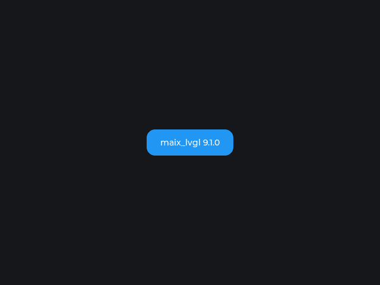
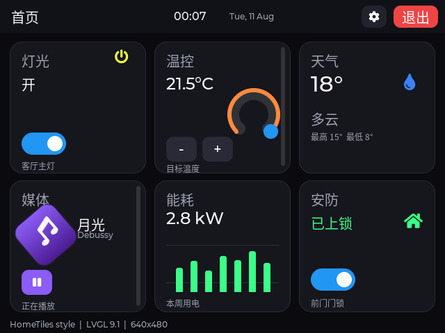
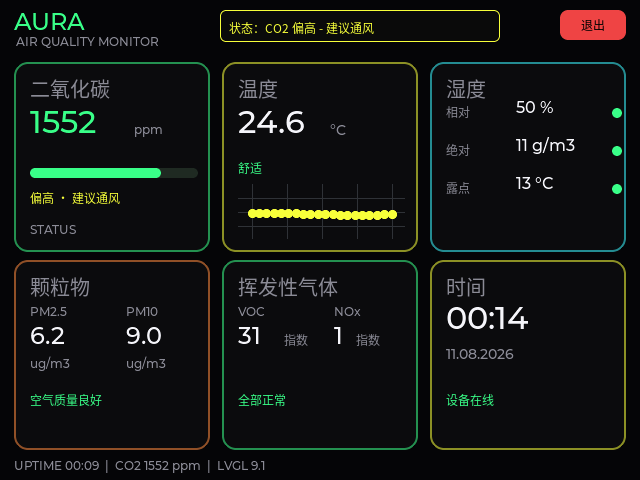
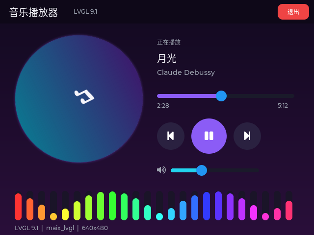
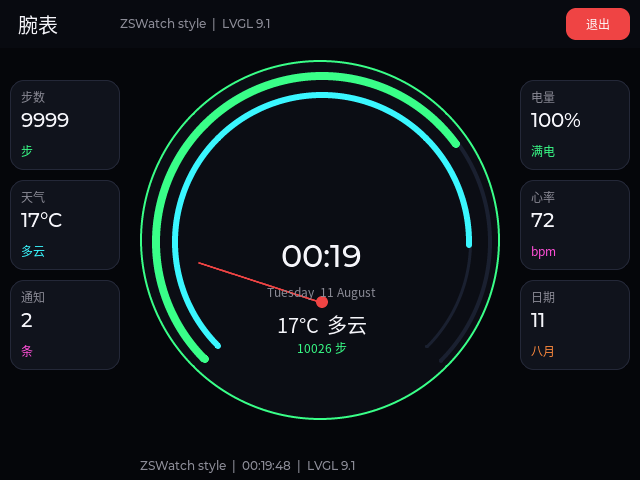

# maix_lvgl

[中文文档](README_ZH.md) | English

LVGL bindings for MaixPy on MaixCAM2 with the MicroPython-style API. This is a
standard **MaixCDK project**: the LVGL library is downloaded and built by
MaixCDK, the binding is generated from that source, and `setup.py` packages the
result the same way MaixPy does.



*Rendered by MaixCAM2 through `maix.display.Display` (640×480, BGRA8888).*

The binding is generated with the generator from
[PyDevices/omnipython-lvgl](https://github.com/PyDevices/omnipython-lvgl)
(MIT), vendored under `tools/omnipython_lvgl/`.

Prebuilt wheel: [Releases](https://github.com/Taoxuan-168/Maix_LVGL/releases).

## Install

### PyPI (recommended)

```bash
python3 -m pip install maix-lvgl
```

`pip` selects the wheel that matches the device (MaixCAM2: aarch64 / Python
3.13, MaixCAM: RISC-V 64 / Python 3.11).  The import name is `maix_lvgl`:

```python
import maix_lvgl as lv
```

### GitHub Release

Install the prebuilt wheel directly from the GitHub Release on the device.

#### MaixCAM2 (aarch64, Python 3.13) — tested

```bash
python3 -m pip install --force-reinstall --no-deps \
  https://github.com/Taoxuan-168/Maix_LVGL/releases/download/v0.1.0/maix_lvgl-0.1.0-cp313-cp313-manylinux2014_aarch64.whl
```

#### MaixCAM (RISC-V 64, Python 3.11) — untested

```bash
python3 -m pip install --force-reinstall --no-deps \
  https://github.com/Taoxuan-168/Maix_LVGL/releases/download/v0.1.0/maix_lvgl-0.1.0-cp311-cp311-linux_riscv64.whl
```

Verify the installation:

```python
import maix_lvgl as lv
print(lv.__version__)
```

Release page:
<https://github.com/Taoxuan-168/Maix_LVGL/releases/tag/v0.1.0>

> The MaixCAM wheel is built but **not tested on MaixCAM hardware**; only the
> MaixCAM2 wheel has been verified.  If pip reports "not a supported wheel",
> check the device platform and Python version (MaixCAM2: aarch64 / 3.13,
> MaixCAM: RISC-V 64 / 3.11).

## Quick start

```python
import time
from maix import app, display, touchscreen
import maix_lvgl as lv

disp = display.Display()
ts = touchscreen.TouchScreen()

try:
    lv.init(disp, ts)               # pass MaixPy display + touchscreen

    scr = lv.screen_active()
    btn = lv.button(scr)            # same style as MicroPython's lvgl
    btn.set_size(240, 120)
    btn.center()
    label = lv.label(btn)
    label.set_text("Hello MaixCAM2")

    btn.add_event_cb(lambda e: print("clicked"), lv.EVENT.CLICKED, None)

    while not app.need_exit():
        lv.timer_handler()          # maix_lvgl version: advances the LVGL tick
        time.sleep(0.005)
finally:
    lv.deinit()
    ts.close()
    disp.close()
```


## Feature showcase

`examples/showcase.py` is a four-page interactive demo:

| page | contents |
| --- | --- |
| Controls | buttons, switch, checkbox, slider, bar, arc, dropdown, roller, spinbox, LED |
| Data | live sin/cos chart, table, calendar |
| Input | textarea + on-screen keyboard, list, message box |
| Canvas | direct canvas pixel drawing, property animation, spinner |

Run it on the device, then use the on-screen **Exit** button (top-right):

```bash
python showcase.py
```

Screenshots: `examples/screenshots/{controls,data,input,canvas}.png`.

With `MAIXPY_DEBUG_IMAGES=1` the demo auto-advances the pages, exits after
12 seconds and writes `showcase_<tab>.png` into the skill run artifacts.


## UI style examples

Four self-contained examples reproduce the visual styles collected for this
project.  Each has an on-screen **Exit** button; `--debug-images` captures a
screenshot and exits after 12 seconds.

### HomeTiles — tile dashboard

[`examples/tile_dashboard.py`](examples/tile_dashboard.py)



Tile dashboard with light, climate, weather, media, energy and security cards,
popups, a chart and a rotating cover.

### Project Aura — neon instrument panel

[`examples/neon_dashboard.py`](examples/neon_dashboard.py)



Black background with neon outlines: CO2, temperature, humidity, particle,
VOC/NOx and time cards, live trend and breathing borders.

### LVGL Music — player

[`examples/music_player.py`](examples/music_player.py)



Rotating cover, progress/volume sliders, previous/play/next controls and a
24-bar spectrum analyzer.

### ZSWatch — watchface

[`examples/watchface.py`](examples/watchface.py)



Round dial with neon step/battery arcs, a seconds hand and tappable theme
switching.

Run one directly on the device:

```bash
python examples/tile_dashboard.py
```

## Chinese text with FreeType

LVGL's built-in Montserrat fonts only cover Latin.  The build enables
`LV_USE_FREETYPE` (see `tools/patch_maixcdk.py`) and links MaixCDK's
`freetype` component, so device fonts can be loaded at runtime.

Complete example (run on the device):

```python
import time

from maix import app, display, touchscreen

import maix_lvgl as lv

FONT = "/maixapp/share/font/SourceHanSansCN-Regular.otf"


def main():
    disp = display.Display()
    ts = touchscreen.TouchScreen()
    running = [True]
    font = None
    try:
        lv.init(disp, ts)
        scr = lv.screen_active()
        scr.set_style_bg_color(lv.color_hex(0x101018), 0)
        scr.set_style_bg_opa(lv.OPA.COVER, 0)

        # lv_init() already initializes FreeType, and lv_deinit() cleans it
        # up.  Do not call lv.freetype_init()/lv.freetype_uninit() manually.
        font = lv.freetype_font_create(
            FONT,
            0,      # LV_FREETYPE_FONT_RENDER_MODE_BITMAP
            24,     # pixel size
            0,      # LV_FREETYPE_FONT_STYLE_NORMAL
        )
        if font is None:
            raise RuntimeError("cannot load " + FONT)

        title = lv.label(scr)
        title.set_text("你好，MaixCAM2！")
        title.set_style_text_font(font, 0)
        title.set_style_text_color(lv.color_hex(0xFFFFFF), 0)
        title.set_pos(20, 20)

        body = lv.label(scr)
        body.set_text(
            "这是 LVGL FreeType 渲染的中文。\n"
            "汉字：你好世界\n"
            "标点：，。！？：；（）\n"
            "混合：LVGL 9.1 中文 123"
        )
        body.set_style_text_font(font, 0)
        body.set_style_text_color(lv.color_hex(0x9CA3AF), 0)
        body.set_pos(20, 70)

        def on_exit(event):
            running[0] = False

        button = lv.button(scr)
        button.set_pos(20, 230)
        button.set_size(120, 44)
        button.add_event_cb(on_exit, lv.EVENT.CLICKED, None)
        button_label = lv.label(button)
        button_label.set_text("退出")
        button_label.set_style_text_font(font, 0)
        button_label.center()

        while not app.need_exit() and running[0]:
            lv.timer_handler()
            time.sleep(0.005)

        # Delete widgets that use the font first, then the font itself.
        button.delete()
        body.delete()
        title.delete()
        font.freetype_font_delete()
        font = None
    finally:
        if font is not None:
            font.freetype_font_delete()
        lv.deinit()
        ts.close()
        disp.close()


if __name__ == "__main__":
    main()
```

Notes:

- `lv_init()` initializes FreeType and `lv_deinit()` cleans it up.  Calling
  `lv.freetype_init()` / `lv.freetype_uninit()` manually and then `lv.deinit()`
  makes cleanup run twice and can hang.
- Delete widgets that use the font before `font.freetype_font_delete()`.
- The Source Han font is ~8.3 MB; create it on demand.  The glyph cache is
  `LV_FREETYPE_CACHE_SIZE` (768 KB by default).
- Screenshot: `examples/screenshots/cjk_font.png`.

## Debugging with AI (screen capture loop)

`maix_lvgl` renders into a Python `bytearray` (`driver._buffer`, BGRA8888)
and pushes the same bytes to `maix.display.Display`.  A script can therefore
turn the exact frame the user sees into a PNG and hand it back to an assistant
or a CI job:

```python
img = image.from_bytes(
    driver.width, driver.height,
    image.Format.FMT_BGRA8888,
    bytes(driver._buffer), True,
)
img.save("/tmp/maixpy_skill/<run>/artifacts/frame.png")
```

`examples/showcase.py` implements this behind `MAIXPY_DEBUG_IMAGES=1` (the
skill CLI sets it with `--debug-images`): it captures every 2 s, cycles
through the four pages, and exits after 12 s.  Normal user runs never capture.

### Run loop

```bash
python3 <skill>/scripts/maixpy_skill/cli.py run examples/showcase.py --debug-images
```

The CLI enters development mode, stops the launcher, runs the script on the
device, then pulls the run directory back to `.maixpy/runs/<run_id>/`:

| artifact | use |
| --- | --- |
| `stdout.log` / `stderr.log` | prints, tracebacks, crash output |
| `summary.json` | `exit_code` (139 SIGSEGV, 135 SIGBUS, 124 timeout) |
| `device-last-run.log` | full device log |
| `artifacts/*.png` | exact LVGL frames, readable as images |

### Pixel checks without a screenshot

Tests can assert on the raw frame buffer:

```python
idx = (h // 2) * w * 4 + (w // 2) * 4
b, g, r, a = driver._buffer[idx: idx + 4]
assert (r, g, b) == (255, 0, 0)
```

### Notes

- Capture code lives only in `examples/` and `tests/`; the wheel contains no
  debug switches, debug symbols, or capture paths.
- Real touch input still needs a person (or `send_event` for synthetic events).
- Keep `--debug-images` out of final user-facing runs.

## Standard MaixCDK project layout

```
maix_lvgl/
├── CMakeLists.txt           # MaixCDK project entry
├── project.py               # MaixCDK build driver
├── Kconfig                  # project config
├── main/                    # entry component (depends on lvgl_binding)
├── components/lvgl_binding/ # LVGL CPython extension component
│   ├── CMakeLists.txt       # links MaixCDK's lvgl + python3, generates binding
│   ├── component.py         # add_requirements: lvgl, python3
│   └── Kconfig
├── binding/                 # generated C binding + pyi + lv_conf.h
├── runtime/                 # CPython runtime glue (lvpy_runtime.c/h)
├── maix_lvgl/               # Python backend + built extension (in the wheel)
├── tools/
│   ├── maixcdk_lvgl.py      # locate MaixCDK / its LVGL source
│   ├── regenerate_binding.py# regenerate binding from MaixCDK's LVGL (stamped)
│   └── omnipython_lvgl/     # vendored generator (MIT)
├── configs/config_platform_maixcam2.mk
├── setup.py                 # project.py build + wheel packaging (like MaixPy)
└── dist/
```

`components/lvgl_binding` declares `ADD_REQUIREMENTS lvgl python3`, so
MaixCDK downloads its pinned LVGL (9.1.0 today, from
`components/3rd_party/lvgl/Kconfig`), compiles it together with the rest of
the stack, and the binding links against that exact library.

## Building

```bash
export MAIXCDK_PATH=/path/to/MaixCDK

# MaixCAM2 (aarch64, Python 3.13) — tested on hardware
python3 setup.py bdist_wheel --board maixcam2

# MaixCAM (RISC-V, Python 3.11) — NOT tested on hardware
python3.11 setup.py bdist_wheel --board maixcam
```

`--board` also accepts `-b maixcam`, `--board=maixcam`, a positional
`maixcam`/`maixcam2`, or the `MAIX_BOARD` environment variable.  The default
is `maixcam2`.

> **MaixCAM build is untested.**  The `maixcam` wheel targets
> `cp311-linux_riscv64` and is provided for completeness; only the MaixCAM2
> build has been verified on hardware.

What happens:

1. `setup.py` runs `python project.py build -p <board> --release` (same
   pattern as MaixPy's `setup.py`).
2. MaixCDK downloads its LVGL source and dependencies (first build), then the
   `lvgl_binding` component's custom target regenerates
   `binding/lvgl_python.c` from that source when it changed.
3. The component compiles and links against MaixCDK's `lvgl` and `python3`
   components with MaixCDK's cross toolchain.
4. The wheel is packaged with the target tag:
   - MaixCAM2: `cp313-manylinux2014_aarch64`,
     `lvgl.cpython-313-aarch64-linux-gnu.so`
   - MaixCAM: `cp311-linux_riscv64`, `lvgl.so`
   Both contain `maix_lvgl/` (`__init__.py`, `driver.py`, the extension) and
   `dl_lib/libdatachannel.so`.

The build also generates MaixPy-style API documentation from
`binding/lvgl.pyi` into `docs/api/` (`api.json`, `config.json`, `README.md`,
`README2.md`, `sidebar.yaml` and `maix_lvgl/{lvgl,maix_lvgl}.md`), the same
build-time flow as MaixPy's `components/maix/gen_api.py` -> `docs/api/maix`.
The generated docs are a build artifact and are not tracked in git; run
`python3 tools/gen_api_docs.py` to regenerate them alone.

### Fresh clone / clean build

Only tracked sources are required.  `binding/lvgl_python.c`, `binding/lvgl.pyi`,
`binding/lv_conf.h`, `build/`, `dist/` and `docs/api/` are generated:

```bash
git clone https://github.com/Taoxuan-168/Maix_LVGL.git
cd Maix_LVGL
export MAIXCDK_PATH=/path/to/MaixCDK

# MaixCAM2 (host Python 3.13)
python3 -m pip install 'pycparser>=3.0'
python3 setup.py bdist_wheel --board maixcam2

# MaixCAM (host Python 3.11; untested)
python3.11 -m pip install --user 'pycparser>=3.0'
python3.11 setup.py bdist_wheel --board maixcam
```

The build automatically:

- downloads LVGL/freetype into MaixCDK on first use,
- applies `tools/patch_maixcdk.py` (enables `LV_USE_FREETYPE`, links the
  freetype component and adds CMake 4 compatibility),
- applies `tools/patch_lvgl.py` (LVGL 9.1.0 observer/canvas fixes),
- regenerates `binding/lvgl_python.c` and `binding/lvgl.pyi`,
- builds and packages `dist/maix_lvgl-*.whl`.

Build requirements: MaixCDK with the target toolchain/Python headers under
`dl/extracted`, **host Python 3.13 for MaixCAM2** and **host Python 3.11 for
MaixCAM**, **cmake 3.x or 4.x** (`tools/patch_maixcdk.py` passes
`-DCMAKE_POLICY_VERSION_MINIMUM=3.5` to freetype for CMake 4), `pycparser`
(`pip install 'pycparser>=3.0'`), host `gcc`, and network access for the
first dependency download.

For the MaixCAM build, `python3-config` must also resolve to Python 3.11.
If your system default is another version, prepend a 3.11 bin directory or a
small wrapper:

```bash
mkdir -p /tmp/py311-bin
printf '#!/bin/sh\nexec /usr/bin/python3.11-config "$@"\n' > /tmp/py311-bin/python3-config
chmod +x /tmp/py311-bin/python3-config
PATH=/tmp/py311-bin:$PATH python3.11 setup.py bdist_wheel --board maixcam
```

Binding regeneration is cached in `binding/.binding_stamp.json` and runs
automatically during `project.py build`. Force it with:

```bash
python3 tools/regenerate_binding.py --force
# or
./scripts/regenerate_binding.sh
```

`--skip-build` reuses the existing MaixCDK build when re-packaging.  The
build directory is tracked per board; switching boards without
`--skip-build` triggers a clean rebuild:

```bash
python3 setup.py bdist_wheel --board maixcam2 --skip-build
```

## Configuration notes

The binding uses MaixCDK's LVGL `lv_conf.h` as-is (so struct layouts match the
library MaixCDK compiles): `LV_USE_OS=LV_OS_PTHREAD`, `LV_USE_RLOTTIE=1`,
`LV_COLOR_DEPTH=32`. Two build-system-only bits are removed
(`global_config.h` include and the `lv_ui_mutex_*` declarations), and the
generated C has Python access stripped from fields whose types are
`pthread_mutex_t` (`lv_thread_sync_t`, `lv_draw_global_info_t.circle_cache_mutex`,
`lv_cache_t.lock`), which have no Python representation.

MaixCAM2's display only accepts BGRA8888, which is byte-identical to LVGL's
little-endian ARGB8888 output; `FMT_RGB565` is rejected by the display driver.

## Tick and main loop

`lv_tick_set_cb()` cannot be used from the generated CPython binding: that API
takes no `user_data`, so the Python callback is not kept alive and the tick
stays at 0 (no LVGL timer, including the indev read timer, ever fires).
`maix_lvgl.timer_handler()` advances `lv_tick_inc()` on the main thread before
calling LVGL's timer handler; the re-exported `lv.timer_handler` already
points to it.

Do not call the raw `lvgl.timer_handler()` unless you advance `lv_tick_inc()`
yourself.

## Verified

- Wheel built through MaixCDK's `project.py`, installed on MaixCAM2
  (MaixPy 4.12.5) from inside `maix_lvgl/`; 640×480 BGRA8888 rendering
  confirmed by screenshot.
- Touch indev: 25 read callbacks in 50 timer-handler passes; manual
  `indev.read()` also wired correctly.
- Earlier builds of the same backend: 74 consecutive `lv.EVENT.CLICKED`
  hits, clean `lv.deinit()`.

## Known limitations

- **JPEG images**: upstream jpegio depends on LVGL 9.5 image-cache internals
  that do not exist in 9.1.0, so it is not compiled.
- **Chinese text**: only Montserrat fonts are enabled (MaixCDK's LVGL config).
- **Touch targets**: touch is verified; widgets must cover the actual touched
  area.
- **Display ownership**: only one `maix.display.Display` user at a time; stop
  the launcher/other apps before `lv.init()`.

## Binding fixes (2026-11)

The binding generator and runtime were fixed after an API sweep on MaixCAM2:

- `menu_page.set_page_title()` / `set_page_title_static()` (previously bound to
  `menu` and freed a bogus pointer).
- `image_decoder_t.delete()`, `scale_section_t.set_range()`,
  `image_src_get_type()`, `image_decoder_create()`, `image_cache_resize()`,
  `image_header_cache_resize()`, `image_cache_drop()` and
  `canvas_buf_size()` are now module-level functions where the C API is not a
  receiver method.
- `lv.ANIM_ENABLE`, `lv.SCREEN_LOAD_ANIM` and `lv.SYMBOL` are exported.
- `anim_set_exec_cb(anim, cb)` is provided at the `maix_lvgl` module level
  (LVGL's `lv_anim_set_exec_cb` has no user_data slot, so the raw binding is
  private). The callback is called as `cb(anim, value)`; use
  `anim.set_custom_exec_cb()` for the same behaviour directly.
- `grid_dsc_array` accepts lists as well as `array.array`.
- `remove_event_cb()` / `remove_event_cb_with_user_data()` now match the
  trampoline used by `add_event_cb`.
- `observer.remove()` no longer leaves a dangling `LV_EVENT_DELETE` hook
  (LVGL 9.1.0 upstream fix, applied by `tools/patch_lvgl.py`).
- `canvas.copy_buf()` no longer hangs on same-format copies (same upstream
  fix).
- `obj.set_user_data()` / `timer.set_user_data()` / `anim.set_var()` /
  `subject.init_pointer()` accept widget objects; plain Python ints remain
  unsupported because LVGL stores a `void *`.
- `font.set_kerning()` is not exposed: built-in Montserrat fonts are const
  data and writing them crashes.
