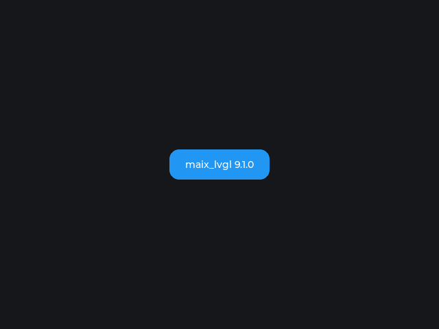
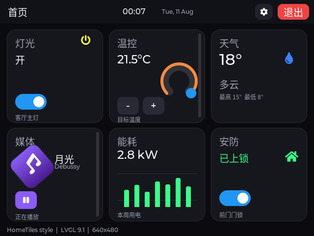
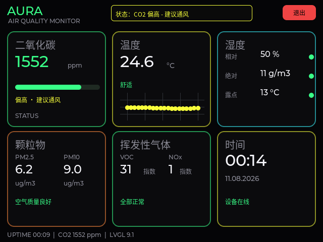
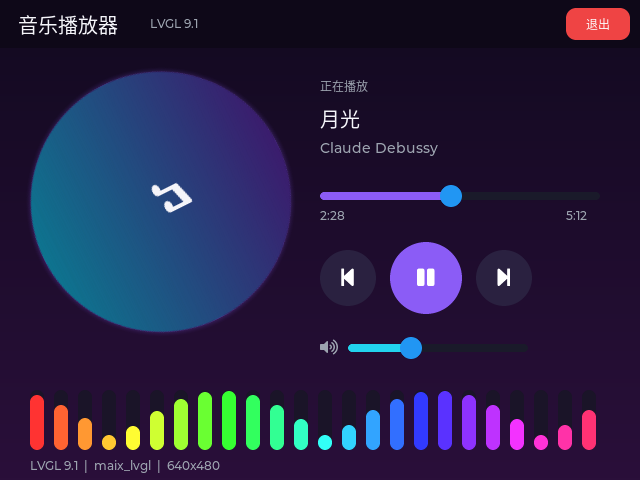
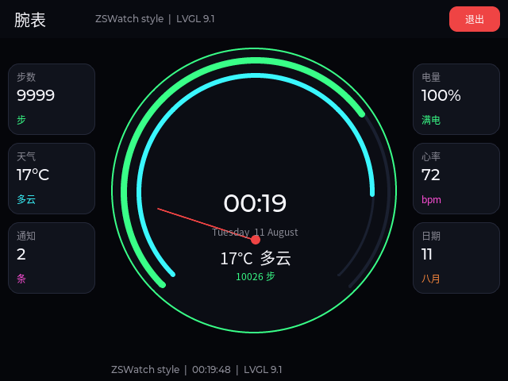
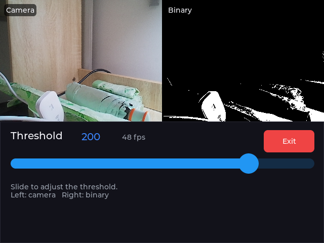
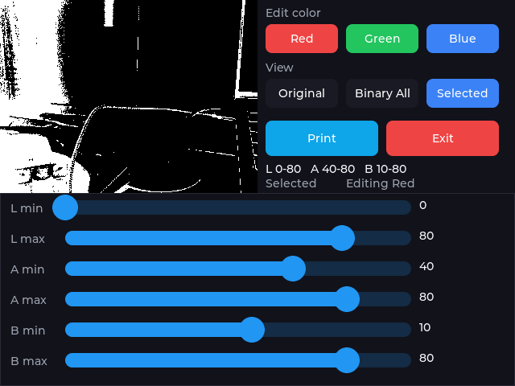
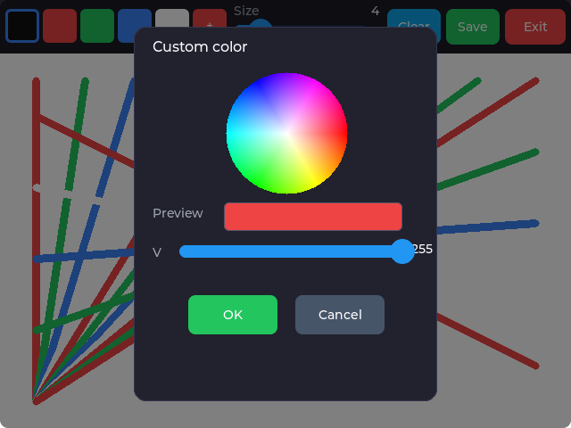

# maix_lvgl

[English](README.md) | 中文

面向 MaixPy（MaixCAM/MaixCAM2）和桌面 Linux / Windows（x86_64，SDL）的
LVGL 绑定，
API 与 MicroPython 的 `lvgl` 写法一致。MaixPy 部分是一个**标准 MaixCDK
工程**：LVGL 由 MaixCDK 自动下载并编译，绑定基于 MaixCDK 的 LVGL 源码生成，
`setup.py` 按 MaixPy 的方式打包 wheel。



*由 MaixCAM2 通过 `maix.display.Display` 实际渲染（640×480，BGRA8888）。*

绑定生成参考并使用了 [PyDevices/omnipython-lvgl](https://github.com/PyDevices/omnipython-lvgl)
的生成器（MIT 协议，已内置在 `tools/omnipython_lvgl/`）。

预构建 wheel：[Releases](https://github.com/Taoxuan-168/Maix_LVGL/releases)。

## 安装

### PyPI（推荐）

```bash
python3 -m pip install maix-lvgl
```

`pip` 会自动选择与平台匹配的 wheel（MaixCAM2：aarch64 / Python 3.13；
MaixCAM：RISC-V 64 / Python 3.11；桌面 Linux / Windows：x86_64 / Python 3.13）。
导入名是 `maix_lvgl`：

```python
import maix_lvgl as lv
```

### GitHub Release

在设备上直接从 GitHub Release 安装预编译 wheel。

#### MaixCAM2（aarch64，Python 3.13）— 已测试

```bash
python3 -m pip install --force-reinstall --no-deps \
  https://github.com/Taoxuan-168/Maix_LVGL/releases/download/v0.1.1/maix_lvgl-0.1.1-cp313-cp313-manylinux2014_aarch64.whl
```

#### MaixCAM（RISC-V 64，Python 3.11）— 未测试

```bash
python3 -m pip install --force-reinstall --no-deps \
  https://github.com/Taoxuan-168/Maix_LVGL/releases/download/v0.1.1/maix_lvgl-0.1.1-cp311-cp311-musllinux_1_2_riscv64.whl
```

验证安装：

```python
import maix_lvgl as lv
print(lv.__version__)
```

Release 页面：
<https://github.com/Taoxuan-168/Maix_LVGL/releases/tag/v0.1.1>

> MaixCAM wheel 已构建但**未在 MaixCAM 硬件测试**；只有 MaixCAM2 wheel 验证过。
> 如果 pip 提示 “not a supported wheel”，请确认设备平台和 Python 版本
> （MaixCAM2：aarch64 / 3.13；MaixCAM：RISC-V 64 / 3.11）。

## 快速开始

```python
import time
from maix import app, display, touchscreen
import maix_lvgl as lv

disp = display.Display()
ts = touchscreen.TouchScreen()

try:
    lv.init(disp, ts)               # 直接传入 MaixPy 屏幕和触摸屏

    scr = lv.screen_active()
    btn = lv.button(scr)            # 与 MicroPython 写法一致
    btn.set_size(240, 120)          # 按钮大一些，方便点击
    btn.center()
    label = lv.label(btn)
    label.set_text("Hello MaixCAM2")

    btn.add_event_cb(lambda e: print("clicked"), lv.EVENT.CLICKED, None)

    while not app.need_exit():
        lv.timer_handler()          # maix_lvgl 版本：自动推进 tick
        time.sleep(0.005)
finally:
    lv.deinit()
    ts.close()
    disp.close()
```


## 桌面 Linux / Windows（x86_64）

在普通 x86_64 Linux 桌面上，同一个包会自动使用 LVGL 的 SDL 窗口驱动，而不是
MaixPy 的 display：

```python
import time
import maix_lvgl as lv

lv.init(800, 600)              # SDL 窗口尺寸
scr = lv.screen_active()
label = lv.label(scr)
label.set_text("Hello from Linux")
label.center()

try:
    while True:
        lv.timer_handler()
        time.sleep(0.01)
except KeyboardInterrupt:
    pass
finally:
    lv.deinit()
```

`maix_lvgl` 会检测 `maix` 是否可导入：在 MaixCAM 上继续使用
`display.Display` + `touchscreen.TouchScreen`；其他环境则创建 SDL 窗口并接入
鼠标、键盘输入。

- PyPI 上的 `manylinux` wheel 已内置 SDL2，需要 glibc 2.28+
  （Ubuntu 20.04+ / Debian 10+）。
- GitHub Release 上的 `linux_x86_64` wheel 使用系统 `libSDL2-2.0.so.0`
  （`sudo apt install libsdl2-2.0-0`）。

构建桌面版：

```bash
tools/build_linux.sh

# 可移植的 manylinux 构建（Docker）
docker run --rm -v "$PWD/..:/src" -w /src/maix_lvgl \
  quay.io/pypa/manylinux_2_28_x86_64 bash tools/build_linux_manylinux.sh
```


### Windows

`win_amd64` wheel 使用 mingw-w64 交叉编译，内置 `SDL2.dll`，面向 64 位
Python 3.13。上面的 SDL 示例同样适用：

```python
lv.init(800, 600)
```

```bash
python -m pip install maix-lvgl
```

当前 Windows wheel 在 Linux 上交叉编译，并通过 PE 依赖/导出检查，但尚未在
Windows 实机运行。

在 Linux 上构建：

```bash
WIN_PY_DIR=/path/to/windows-python/tools \
WIN_SDL_DIR=/path/to/SDL2/x86_64-w64-mingw32 \
tools/build_windows.sh
```

以下 UI 示例（`demo.py`、`showcase.py`、`tile_dashboard.py`、
`neon_dashboard.py`、`music_player.py`、`watchface.py`、`drawing_board.py`）在
桌面 Linux 上同样可以运行：

```bash
cd examples
python demo.py
```

摄像头示例（`threshold_editor.py`、`multi_color_threshold.py`）需要 MaixPy
摄像头，在桌面 Linux 上会打印提示并退出。


## 功能演示

`examples/showcase.py` 是一个四页可交互演示：

| 页面 | 内容 |
| --- | --- |
| Controls | 按钮、开关、复选框、滑块、进度条、圆弧、下拉框、滚轮、数字框、LED |
| Data | 实时 sin/cos 曲线、表格、日历 |
| Input | 文本框 + 屏幕键盘、列表、消息框 |
| Canvas | canvas 逐像素绘制、属性动画、spinner |

在设备上运行后，点击右上角 **Exit** 按钮退出：

```bash
python showcase.py
```

截图：`examples/screenshots/{controls,data,input,canvas}.png`。

设置 `MAIXPY_DEBUG_IMAGES=1` 时，演示会自动切换页面、12 秒后退出，并把
`showcase_<tab>.png` 写入 skill 运行目录的 artifacts。


## UI 风格示例

四个自包含示例对应前面收集的界面风格。每个都有屏幕 **退出** 按钮；
`--debug-images` 会截图并在 12 秒后退出。

### HomeTiles — 磁贴仪表盘

[`examples/tile_dashboard.py`](examples/tile_dashboard.py)



灯光、温控、天气、媒体、能耗、安防卡片，带弹窗、图表和旋转封面。

### Project Aura — 霓虹仪表盘

[`examples/neon_dashboard.py`](examples/neon_dashboard.py)



黑底霓虹描边：CO2、温度、湿度、颗粒物、VOC/NOx、时间卡片，实时趋势和呼吸边框。

### LVGL Music — 播放器

[`examples/music_player.py`](examples/music_player.py)



旋转封面、进度/音量滑块、上一首/播放/下一首、24 柱频谱。

### ZSWatch — 表盘

[`examples/watchface.py`](examples/watchface.py)



圆形表盘、霓虹步数/电量弧、秒针，点击表盘切换主题。

在设备上直接运行：

```bash
python examples/tile_dashboard.py
```

## 摄像头阈值编辑器

两个用于在实时摄像头上调整颜色阈值的示例，图像处理全部使用 MaixPy API。

### 二值阈值编辑器

[`examples/threshold_editor.py`](examples/threshold_editor.py)

单组灰度阈值（0–255），左侧显示摄像头画面、右侧显示二值结果，滑动滑块立即生效。



### 多颜色 LAB 阈值编辑器

[`examples/multi_color_threshold.py`](examples/multi_color_threshold.py)

参考 MaixCDK 的 `app_find_blobs`：支持红 / 绿 / 蓝三组颜色阈值，当前颜色
6 个 LAB 滑块，以及三种视图：

- `Original` — 摄像头原图
- `Binary All` — 三组颜色阈值合并
- `Selected` — 只显示当前选中颜色

`Print` 会把完整阈值表输出到 stdout。滑块相互独立、调整立即生效；min/max
拖反时不会匹配任何像素。



在设备上运行：

```bash
python examples/threshold_editor.py
python examples/multi_color_threshold.py
```

## 画板

[`examples/drawing_board.py`](examples/drawing_board.py)

触摸画板：5 个预设颜色、`+` 按钮打开自定义 HSV 色盘、笔刷大小、清屏、
保存 PNG 和退出。画布 640×420，绘制时由 LVGL 指针输入设备写入 canvas 像素。



在设备上运行：

```bash
python examples/drawing_board.py
```

保存的图片位于 `/root/drawing.png`。

## 使用 FreeType 显示中文

LVGL 内置的 Montserrat 字体只覆盖拉丁字符。构建时会启用 `LV_USE_FREETYPE`
（见 `tools/patch_maixcdk.py`）并链接 MaixCDK 的 `freetype` 组件，因此可以在
运行时加载设备字体。

完整可运行示例（在设备上执行）：

```python
import time

from maix import app, display, touchscreen

import maix_lvgl as lv

FONT = "/maixapp/share/font/SourceHanSansCN-Regular.otf"


def main():
    disp = display.Display()
    ts = touchscreen.TouchScreen()
    running = [True]
    font = None
    try:
        lv.init(disp, ts)
        scr = lv.screen_active()
        scr.set_style_bg_color(lv.color_hex(0x101018), 0)
        scr.set_style_bg_opa(lv.OPA.COVER, 0)

        # lv_init() 已经初始化 FreeType，lv_deinit() 会自动清理。
        # 不要再手动调用 lv.freetype_init()/lv.freetype_uninit()。
        font = lv.freetype_font_create(
            FONT,
            0,      # LV_FREETYPE_FONT_RENDER_MODE_BITMAP
            24,     # 像素高度
            0,      # LV_FREETYPE_FONT_STYLE_NORMAL
        )
        if font is None:
            raise RuntimeError("无法加载 " + FONT)

        title = lv.label(scr)
        title.set_text("你好，MaixCAM2！")
        title.set_style_text_font(font, 0)
        title.set_style_text_color(lv.color_hex(0xFFFFFF), 0)
        title.set_pos(20, 20)

        body = lv.label(scr)
        body.set_text(
            "这是 LVGL FreeType 渲染的中文。\n"
            "汉字：你好世界\n"
            "标点：，。！？：；（）\n"
            "混合：LVGL 9.1 中文 123"
        )
        body.set_style_text_font(font, 0)
        body.set_style_text_color(lv.color_hex(0x9CA3AF), 0)
        body.set_pos(20, 70)

        def on_exit(event):
            running[0] = False

        button = lv.button(scr)
        button.set_pos(20, 230)
        button.set_size(120, 44)
        button.add_event_cb(on_exit, lv.EVENT.CLICKED, None)
        button_label = lv.label(button)
        button_label.set_text("退出")
        button_label.set_style_text_font(font, 0)
        button_label.center()

        while not app.need_exit() and running[0]:
            lv.timer_handler()
            time.sleep(0.005)

        # 先删除使用该字体的控件，再删除字体。
        button.delete()
        body.delete()
        title.delete()
        font.freetype_font_delete()
        font = None
    finally:
        if font is not None:
            font.freetype_font_delete()
        lv.deinit()
        ts.close()
        disp.close()


if __name__ == "__main__":
    main()
```

说明：

- `lv_init()` 会初始化 FreeType，`lv_deinit()` 会自动清理。手动调用
  `lv.freetype_init()` / `lv.freetype_uninit()` 后再 `lv.deinit()` 会重复清理，
  可能导致挂起。
- 先删除使用该字体的控件，再调用 `font.freetype_font_delete()`。
- 思源黑体约 8.3 MB，按需创建；字形缓存由 `LV_FREETYPE_CACHE_SIZE`
  控制（默认 768 KB）。
- 截图：`examples/screenshots/cjk_font.png`。

## 让 AI 看见调试信息（截图闭环）

`maix_lvgl` 渲染到 Python `bytearray`（`driver._buffer`，BGRA8888），并把同一份
字节推送到 `maix.display.Display`。因此脚本可以把用户看到的画面原样保存成 PNG，
交给 AI 或 CI 查看：

```python
img = image.from_bytes(
    driver.width, driver.height,
    image.Format.FMT_BGRA8888,
    bytes(driver._buffer), True,
)
img.save("/tmp/maixpy_skill/<run>/artifacts/frame.png")
```

`examples/showcase.py` 通过 `MAIXPY_DEBUG_IMAGES=1` 实现该逻辑（skill CLI 的
`--debug-images` 会设置它）：每 2 秒截图、自动切换四个页面、12 秒后退出。
正常用户运行不会截图。

### 调试运行命令

```bash
python3 <skill>/scripts/maixpy_skill/cli.py run examples/showcase.py --debug-images
```

CLI 会自动进入开发模式、停止 launcher、在设备上运行脚本，然后把运行目录拉回
`.maixpy/runs/<run_id>/`：

| 产物 | 用途 |
| --- | --- |
| `stdout.log` / `stderr.log` | 打印输出、Python traceback、崩溃信息 |
| `summary.json` | `exit_code`（139=SIGSEGV、135=SIGBUS、124=超时） |
| `device-last-run.log` | 设备端完整日志 |
| `artifacts/*.png` | LVGL 实际渲染画面，可直接作为图片读取 |

### 不截图也能做像素校验

测试可以直接读取帧缓冲：

```python
idx = (h // 2) * w * 4 + (w // 2) * 4
b, g, r, a = driver._buffer[idx: idx + 4]
assert (r, g, b) == (255, 0, 0)
```

### 说明

- 截图代码只存在于 `examples/` 和 `tests/`；wheel 内没有调试开关、调试符号
  或截图路径。
- 真实触摸输入仍需要人工操作（或用 `send_event` 发送合成事件）。
- 最终用户运行不要带 `--debug-images`。

## 标准 MaixCDK 工程结构

```
maix_lvgl/
├── CMakeLists.txt           # MaixCDK 工程入口
├── project.py               # MaixCDK 构建驱动
├── Kconfig                  # 工程配置
├── main/                    # 入口组件（依赖 lvgl_binding）
├── components/lvgl_binding/ # LVGL CPython 扩展组件
│   ├── CMakeLists.txt       # 链接 MaixCDK 的 lvgl + python3，并生成绑定
│   ├── component.py         # add_requirements: lvgl, python3
│   └── Kconfig
├── binding/                 # 生成的 C 绑定 + pyi + lv_conf.h
├── runtime/                 # CPython 运行时胶水（lvpy_runtime.c/h）
├── maix_lvgl/               # Python 后端 + 构建出的扩展（wheel 中）
│   └── linux_driver.py      # 桌面 Linux 的 SDL 窗口后端
├── linux/                   # 桌面 Linux 的 lv_conf.h + 生成的绑定
├── windows/                 # Windows 的 lv_conf.h + 生成的绑定
├── tools/
│   ├── maixcdk_lvgl.py      # 定位 MaixCDK 及其 LVGL 源码
│   ├── regenerate_binding.py# 从 MaixCDK 的 LVGL 重新生成绑定（带 stamp 缓存）
│   ├── regenerate_linux_binding.py
│   ├── build_linux.sh       # 本机 x86_64 SDL wheel 构建
│   ├── build_linux_manylinux.sh
│   ├── regenerate_windows_binding.py
│   ├── build_windows.sh
│   ├── build_windows_wheel.py
│   └── omnipython_lvgl/     # 内置生成器（MIT）
├── configs/config_platform_maixcam2.mk
├── setup.py                 # project.py build + wheel 打包（模仿 MaixPy）
├── setup_linux.py           # 桌面 Linux wheel 打包
└── dist/
```

`components/lvgl_binding` 通过 `ADD_REQUIREMENTS lvgl python3` 依赖 MaixCDK 的
LVGL 组件：MaixCDK 会自动下载其 Kconfig 固定的 LVGL（当前 9.1.0）、编译整条
依赖栈，绑定则链接这份实际的 LVGL 库。

## 构建

```bash
export MAIXCDK_PATH=/path/to/MaixCDK

# MaixCAM2（aarch64，Python 3.13）— 已在硬件测试
python3 setup.py bdist_wheel --board maixcam2

# MaixCAM（RISC-V，Python 3.11）— 未在硬件测试
python3.11 setup.py bdist_wheel --board maixcam
```

`--board` 也支持 `-b maixcam`、`--board=maixcam`、位置参数
`maixcam`/`maixcam2`，或环境变量 `MAIX_BOARD`。默认是 `maixcam2`。

桌面 Linux（x86_64，SDL）：

```bash
# 本机构建（需要 libsdl2-dev 和 Python 头文件）
tools/build_linux.sh

# manylinux_2_28 容器构建（PyPI 兼容标签）
docker run --rm -v "$PWD/..:/src" -w /src/maix_lvgl \
  quay.io/pypa/manylinux_2_28_x86_64 bash tools/build_linux_manylinux.sh
```

> **MaixCAM 构建未测试。** `maixcam` wheel 的目标是
> `cp311-musllinux_1_2_riscv64`，仅为完整性提供；只有 MaixCAM2 构建在硬件上验证过。

流程：

1. `setup.py` 调用 `python project.py build -p <board> --release`（与 MaixPy
   的 `setup.py` 相同模式）。
2. MaixCDK 下载其 LVGL 源码和依赖（首次构建）；`lvgl_binding` 组件的自定义
   目标在源码变化时从 MaixCDK 的 LVGL 重新生成 `binding/lvgl_python.c`。
3. 组件用 MaixCDK 的交叉工具链编译，并链接 MaixCDK 的 `lvgl`、`python3`
   组件。
4. 按目标平台打包：
   - MaixCAM2：`cp313-manylinux2014_aarch64`，
     `lvgl.cpython-313-aarch64-linux-gnu.so`
   - MaixCAM：`cp311-musllinux_1_2_riscv64`，`lvgl.so`
   两者都包含 `maix_lvgl/`（`__init__.py`、`driver.py`、扩展）和
   `dl_lib/libdatachannel.so`。

构建时还会从 `binding/lvgl.pyi` 生成 MaixPy 风格的 API 文档到 `docs/api/`
（`api.json`、`config.json`、`README.md`、`README2.md`、`sidebar.yaml`，以及
`maix_lvgl/{lvgl,maix_lvgl}.md` 模块页），与 MaixPy 的
`components/maix/gen_api.py` → `docs/api/maix` 采用相同的构建时流程；
生成物不纳入 git，可单独运行 `python3 tools/gen_api_docs.py` 重新生成。

### 新手 clone / 干净构建

仓库只包含源码；`binding/lvgl_python.c`、`binding/lvgl.pyi`、
`binding/lv_conf.h`、`build/`、`dist/`、`docs/api/` 都是构建时生成的：

```bash
git clone https://github.com/Taoxuan-168/Maix_LVGL.git
cd Maix_LVGL
export MAIXCDK_PATH=/path/to/MaixCDK

# MaixCAM2（宿主 Python 3.13）
python3 -m pip install 'pycparser>=3.0'
python3 setup.py bdist_wheel --board maixcam2

# MaixCAM（宿主 Python 3.11；未测试）
python3.11 -m pip install --user 'pycparser>=3.0'
python3.11 setup.py bdist_wheel --board maixcam
```

构建会自动：

- 首次使用时把 LVGL/freetype 下载到 MaixCDK；
- 应用 `tools/patch_maixcdk.py`（启用 `LV_USE_FREETYPE`、链接 freetype 组件，
  并加入 CMake 4 兼容）；
- 应用 `tools/patch_lvgl.py`（LVGL 9.1.0 observer/canvas 修复）；
- 重新生成 `binding/lvgl_python.c` 和 `binding/lvgl.pyi`；
- 编译并打包出 `dist/maix_lvgl-*.whl`。

构建要求：带目标工具链/Python 头文件的 MaixCDK（`dl/extracted` 下）、
**MaixCAM2 需要宿主 Python 3.13**、**MaixCAM 需要宿主 Python 3.11**、
**cmake 3.x 或 4.x**（`tools/patch_maixcdk.py` 会为 freetype 传入
`-DCMAKE_POLICY_VERSION_MINIMUM=3.5` 以兼容 CMake 4）、`pycparser`
（`pip install 'pycparser>=3.0'`）、宿主 `gcc`，以及首次下载依赖的网络。

MaixCAM 构建还要求 `python3-config` 指向 Python 3.11。如果系统默认是其他
版本，可把一个 3.11 的 bin 目录或小包装脚本放到 PATH 前面：

```bash
mkdir -p /tmp/py311-bin
printf '#!/bin/sh\nexec /usr/bin/python3.11-config "$@"\n' > /tmp/py311-bin/python3-config
chmod +x /tmp/py311-bin/python3-config
PATH=/tmp/py311-bin:$PATH python3.11 setup.py bdist_wheel --board maixcam
```

绑定重新生成带缓存（`binding/.binding_stamp.json`），在 `project.py build`
时自动执行。强制重生成：

```bash
python3 tools/regenerate_binding.py --force
# 或
./scripts/regenerate_binding.sh
```

打包时复用已有 MaixCDK 构建可用；构建目录按板子跟踪，切换板子且不带
`--skip-build` 会触发干净重编译：

```bash
python3 setup.py bdist_wheel --board maixcam2 --skip-build
```

## 配置说明

绑定直接使用 MaixCDK 的 LVGL `lv_conf.h`（保证与 MaixCDK 编译出的库结构体
一致）：`LV_USE_OS=LV_OS_PTHREAD`、`LV_USE_RLOTTIE=1`、`LV_COLOR_DEPTH=32`。
仅移除两处构建系统专用的内容（`global_config.h` include 和
`lv_ui_mutex_*` 声明）；生成后的 C 会去掉 `pthread_mutex_t` 类型字段的 Python
访问（`lv_thread_sync_t`、`lv_draw_global_info_t.circle_cache_mutex`、
`lv_cache_t.lock`），因为这些类型无法映射到 Python。

MaixCAM2 的显示只接受 BGRA8888，而 LVGL 在小端平台 ARGB8888 的字节顺序正好是
B,G,R,A，与 `FMT_BGRA8888` 一致；显示驱动不接受 `FMT_RGB565`。

## tick 与主循环

`lv_tick_set_cb()` 在生成的 CPython 绑定中不可用：该 API 没有 `user_data`
参数，Python 回调无法被保持，`lv_tick_get()` 会一直是 0，导致 LVGL 的全部
定时器（包括触摸 indev 的读取定时器）都不运行。

因此 `maix_lvgl.timer_handler()` 会在主线程先按单调时间推进
`lv.tick_inc()`，再调用 LVGL 的 `timer_handler()`。重导出的
`lv.timer_handler` 已指向该版本。

不要直接调用原生 `lvgl.timer_handler()`，除非你自己推进 `lv.tick_inc()`。

## 已知限制

- **JPEG 图片**：上游 jpegio 依赖 LVGL 9.5 的 image-cache 内部结构，LVGL 9.1.0
  中不存在，因此未编译。
- **中文显示**：使用 `lv.freetype_font_create()`；内置 Montserrat 字体只覆盖
  拉丁字符。
- **点击目标**：触摸已验证，但控件本身要覆盖你实际触摸的区域。
- **显示独占**：同一时间只能有一个 `maix.display.Display` 使用者，运行前需停止
  launcher 或其他应用。
- **桌面 Linux**：仅支持 x86_64；`manylinux` wheel 需要 glibc 2.28+。
  裸 `linux_x86_64` wheel 只放在 GitHub Release（PyPI 不接受该标签），并依赖
  系统的 SDL2 运行库。
- **Windows**：仅支持 x64 / Python 3.13；wheel 在 Linux 上交叉编译，尚未在
  Windows 实机验证。
